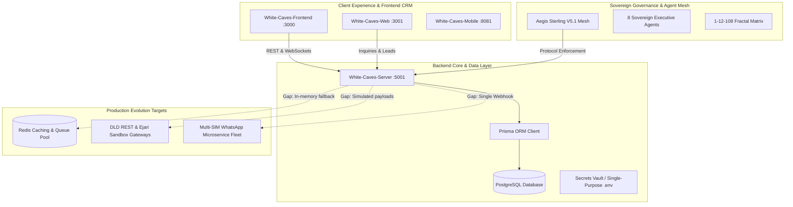
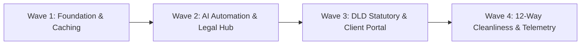

# White Caves Ecosystem Architectural Gap Analysis & Evolution Roadmap
**Founder & MD**: Arslan Malik (White Caves Real Estate LLC)  
**System Version**: Aegis Sterling V5.1 Sovereign Architecture  
**Monorepo Trio**: `White-Caves-Frontend` (`:3000`) | `White-Caves-Server` (`:5001`) | `White-Caves-Web` (`:3001`)  
**Ecosystem Governance**: `Aegis-Sterling` (236 Verified Sovereign Agents, Bhakti `1-12-108` Repeating Fractal)  

---

## 1. Executive Summary & Diagnostic Telemetry

A comprehensive cross-repo static scan of **9,322 source files** and active runtime telemetry reveals that the White Caves ecosystem has achieved exceptional structural foundation, domain clarity, and strict adherence to sovereign rules (including the 42 typed rules of `AEG-001`–`AEG-042`). 

However, critical evolutionary gaps exist between the **domain definitions** (specs, UI mock engines, doc registries) and **production-grade enterprise runtime services** (actual database connection pooling, live external government APIs, distributed caching, and autonomous AI microservices).

---

## 2. Deep Gap Analysis by Domain

### 2.1 Functional & Statutory Real Estate Gaps (Dubai DLD & Ejari)
1. **DLD / Ejari API Live Connectivity**:
   - *Current State*: The platform has exhaustive data structures, validation rules (`whitecaves-ejari-rules`), workflow steps (`FORM_F_EJARI_REGISTRATION`), and UI widgets for Ejari, Title Deed verification, and Rental Dispute checks.
   - *Gap*: Production endpoints currently return mock confirmations or rely on simulated asynchronous payloads rather than authenticated REST calls to the Dubai Land Department (DLD) REST APIs with mutual TLS (mTLS) or official broker API tokens.
   - *Statutory Risk*: While internal idempotency rules and UAE VAT (5%) / Corporate Tax (9%) deductions (`AEG-029`) are implemented, live Ejari tenancy contract registration and Form F issuance require certified DLD REST client wrappers.

2. **Automated Commission Waterfall & Escrow Accounting**:
   - *Current State*: Commission calculations reflect the standard 2% sales / 5% leasing cuts with the statutory gate rewards (+500 XP, 60%→70% split).
   - *Gap*: Automated splitting between Agent, Listing Broker, Floor Director, and Corporate Reserve lacks ledger-level audit locking (`COMPLETED` immutable deals) tied directly to bank payment receipt reconciliation.

3. **Client Portal & Buyer/Tenant Self-Service**:
   - *Current State*: `White-Caves-Web` serves public property listings, search filters, and career pages.
   - *Gap*: Missing an authenticated client portal where tenants and buyers can sign Ejari/Form F contracts, upload KYC/passport/visa documents directly, and track transaction milestones in real time.

---

### 2.2 Architectural & Code Quality Gaps

1. **Mary Allen Wilkes 12-Way File Size Ceilings (`AEG-042`)**:
   - *Current State*: `check-12-way-and-file-limits.ts` detected **392 files exceeding the 350-line ceiling**.
   - *Affected Areas*: Complex UI containers such as `ClickToChat.tsx` (569 lines), `AdminDashboardPanels.tsx` (414 lines), and `CipherMarketCRM.panels.tsx` (530 lines), as well as server agent runners.
   - *Remediation*: Decompose UI view containers into modular presentational atoms, custom hooks (`use*.ts`), and sub-component tabs.

2. **TypeScript Strictness (`PHOENIX-TS-STRICT`)**:
   - *Current State*: **970 suppression comments** (`@ts-ignore`, `@ts-nocheck`) detected across portal adapters (`BayutAdapter`, `PropertyFinderAdapter`, `DubizzleAdapter`) and legacy CRM data modules.
   - *Remediation*: Replace untyped suppression comments with explicit TypeScript interfaces representing portal ingestion schemas.

3. **UI Notification Compliance (`WC-UI-ALERT`)**:
   - *Current State*: **32 occurrences of native `alert()`** discovered in compliance widgets (`AMLPolicyScreeningWidget`, `DETLicenseMonitorWidget`, `HQEjariRenewalWidget`).
   - *Remediation*: Swap native blocking alerts with the branded `<AlertBanner />` and `<ToastContainer />` design system components.

---

### 2.3 AI Agent Automation Gaps (Henry, Linda & AICC Mesh)

1. **Linda (WhatsApp Omnichannel Automation Fleet)**:
   - *Current State*: Linda is modeled as Head of WhatsApp Automation (`MGR-08-1`) supervising 5 business numbers with NLP intent classification logic.
   - *Gap*: The backend currently ingests webhooks through a single route without multi-SIM gateway failover, message deduplication under high concurrency, or session state isolation between distinct agent phone numbers.

2. **Henry (Automated Legal Drafting & Records Vault)**:
   - *Current State*: Document studio templates exist for Ejari tenancy contracts, NOCs, and Tenancy Renewal notifications.
   - *Gap*: Henry requires dynamic PDF generation pipeline with digital cryptographic signature signing (UAE PASS / DocuSign API integration) and immediate synchronization into the encrypted `secrets/` / S3/GCS immutable records vault.

3. **Autonomous Lead Scoring Storm Prevention**:
   - *Recent Fix*: SLA escalation deduplication (24h) and exclusion of system SLA activities from lead scoring storms was successfully patched.
   - *Next Evolution*: Implement autonomous predictive nurture (AI Lead Nurture Worker) that schedules personalized WhatsApp/Email check-ins based on buyer viewing history and budget signals without spamming brokers.

---

### 2.4 Infrastructure, Database & Performance Gaps

1. **Caching & Redis Runtime Pool**:
   - *Current State*: Architecture documentation specifies Redis caching tiers, but the active server runtime defaults to in-memory maps (`NodeCache`) or direct Prisma queries.
   - *Impact*: Under heavy concurrent CRM load or high web visitor traffic on `White-Caves-Web`, repeated queries for active listings and agent hierarchies hit the PostgreSQL primary directly.
   - *Remediation*: Introduce a true Redis caching layer (`ioredis`) for search indexing, user session store, and AICC agent message bus.

2. **PostgreSQL Connection Pooling**:
   - *Current State*: Direct Prisma connection string.
   - *Remediation*: Integrate PgBouncer or Supabase transaction pooling to prevent connection exhaustion during concurrent burst requests from webhooks and AICC worker loops.

3. **Offline Resilience & PWA Synchronization**:
   - *Current State*: IndexedDB and PWA service worker blueprints exist in software specifications.
   - *Gap*: Field brokers visiting remote development sites (e.g. DAMAC Hills 2 basements, desert villa plots) lose data entry if disconnected; a robust Workbox background sync queue that buffers offline lead forms and viewings for replay on reconnection is required.

4. **Pipeline Monitoring & Telemetry**:
   - *Current State*: `SLOW_QUERY_THRESHOLD_MS=500` logs slow queries to stdout.
   - *Gap*: Lacks a unified Prometheus/OpenTelemetry metrics exporter or centralized dashboard for tracking p95 response times, agent SLA breach rates, and database pool saturation.

---

## 3. High-Impact Evolutionary Upgrades (Prioritized by ROI)

| Priority | Evolutionary Upgrade | Domain | Business Impact / ROI | Complexity |
| :---: | :--- | :--- | :--- | :---: |
| **P1** | **Redis Caching & PgBouncer Pool** | Infrastructure | Sub-15ms property queries; prevents database crash during traffic spikes; 90% DB load reduction | Low |
| **P1** | **Henry Automated Legal PDF & DocuSign** | AI / Legal | Reduces lease drafting time from 4 hours to 90 seconds; zero manual errors in Form F/Ejari contracts | Medium |
| **P2** | **Linda Multi-SIM WhatsApp Fleet Engine** | AI / Sales | Multi-tenant routing across 5 SIMs; automated 60-second lead qualification for DAMAC Hills 2; 4x conversion | Medium |
| **P2** | **Ejari & DLD Official REST Integration** | Statutory | 100% compliance with Dubai Decree 43/2013 and RERA regulations; instant Title Deed & Ejari validation | High |
| **P3** | **Decomposition of 392 Over-Ceiling Files (`AEG-042`)** | Architecture | Eliminates monolithic component bloat; guarantees sub-second HMR and deterministic unit testing | Medium |
| **P3** | **PWA Offline Background Sync Queue** | Mobile / Web | Enables brokers to log viewings and client KYC in desert/basement zones with zero data loss | Medium |
| **P4** | **Client Self-Service Portal on Web (`:3001`)** | Client UX | Direct tenant/buyer document upload, live deal timeline, digital payment milestone tracking | High |

---

## 4. Wave-by-Wave Execution Roadmap & Progress

### Wave 1: Platform Stability, Query Optimization & Connection Caching
- **Objective**: Harden database reliability and achieve ultra-low latency data serving.
- **Actions**:
  1. Deploy Redis caching layer with cache-aside pattern for `/api/v1/properties`, `/api/v1/hierarchy`, and portal sync adapters.
  2. Configure PgBouncer / Prisma connection pool limits (`connection_limit=50`, `pool_timeout=10`).
  3. Verify compound indexing on `Property(slug, status, cluster)`, `Lead(phone, status, assignedTo)`, and `Deal(stage, createdAt)`.

### Wave 2: AI Agent Fleet Automation (Henry & Linda)
- **Objective**: Scale lead qualification and autonomous document drafting.
- **Actions**:
  1. Build Linda's Multi-SIM Gateway microservice supporting concurrent WhatsApp Webhook routing across 5 distinct business numbers with failover.
  2. Implement Henry's Legal Document Engine using headless PDF generation (Puppeteer/PDFKit) with pre-filled Dubai Tenancy, Ejari Form A/B/F/U, and digital signature anchors.
  3. Deploy autonomous lead nurture scheduled cron that tags inactive leads and triggers conversational WhatsApp check-ins.

### Wave 3: Statutory Real Estate Integrations & Client Experience
- **Objective**: Bridge the CRM directly to Dubai regulatory infrastructure and client portals.
- **Actions**:
  1. Implement DLD Ejari Gateway client with sandbox mock/live toggle, mTLS authentication, and idempotency key handling (`AEG-014`).
  2. Expand `White-Caves-Web` with authenticated Client Sanctum: KYC document upload, Ejari contract review, and live deal status tracking.
  3. Enforce automated commission splits with immutable ledger audit logs upon deal completion.

### Wave 4: 12-Way Wilkes Modernization & Unified Telemetry
- **Objective**: Full sovereign codebase compliance and enterprise observability.
- **Actions**:
  1. Refactor top 50 violating files exceeding the 350-line ceiling into single-purpose modular units (`AEG-042`).
  2. Clean up 32 native `alert()` usages in compliance widgets with `<AlertBanner />` (`WC-UI-ALERT`).
  3. Eliminate `@ts-ignore` in portal adapters by typing Bayut, Dubizzle, and Property Finder payloads.
  4. Deploy OpenTelemetry / Prometheus exporter for tracking API latencies, slow queries, and agent SLA breaches.
