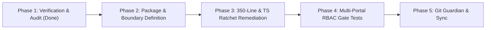

# Aegis V5.0 Sovereign Architectural Consultation & Master Migration Plan
**Document ID:** `AEGIS-PLAN-20261113-MIGRATION-RBAC`  
**Governing Standard:** `TURING-LAW-000`, `TURING-ROOT-007`, `TURING-SEPARATION-010`, `AEG-001`–`AEG-042`  
**Target Mesh:** `White-Caves-Frontend` | `White-Caves-Server` | `White-Caves-Mobile` | `Aegis-Sterling`  

---

## 1. Executive Consultation with Aegis & Forensic Audit

A full forensic inventory between the legacy monorepo (`White-Caves-Frontend`) and the standalone backend repository (`White-Caves-Server`) confirms:

### 1.1 Server Asset Inventory Comparison
| Component Surface | Frontend Monorepo (`White-Caves-Frontend`) | Dedicated Server Repo (`White-Caves-Server`) | Migration & Parity Status |
| :--- | :--- | :--- | :--- |
| **`server/` Core Tree** | 911 files | 911 files | **100% Exact Match** (0 missing server files) |
| **`scripts/` Tooling** | 35 scripts | 35 scripts | **100% Exact Match** |
| **`prisma/` Schemas & Seeds** | `schema.prisma`, `seed.ts`, migrations | `schema.prisma`, `seed.ts`, migrations | **100% Exact Match** |
| **`api/index.ts`** | Vercel Serverless proxy wrapper | Not required (Standalone Node/K8s) | Intentionally isolated to Frontend |
| **Shared Model Layer (`src/`)** | Full frontend UI + domain models | Extracted essential domain models, CRM types & calculation engines | **Migrated & Boot Tested** |

### 1.2 Aegis Server Runtime Verification
The standalone server was booted directly under `nodemon` (`node ./node_modules/tsx/dist/cli.mjs server/index.ts`):
* **HTTP & Socket.IO:** Listening cleanly on `http://localhost:5001`
* **Prisma Engine:** v6.19.3 client generated and active with `$extends` query extensions
* **Schedulers & AI Mesh:** Linda, Nadia, Nina, Mary, Henry assistant handlers (all 5) registered
* **Cron Services:** 8 background jobs registered with `node-cron`

---

## 2. RBAC & Portal User Tier Architecture (Staff vs. Clients)

Per `AEG-004`, `AEG-039`, and `server/middleware/rbac.ts`, White Caves strictly enforces an **orthogonal dual-track identity model**:

```mermaid
graph TD
    User["Base User Account (Auth, Session, JWT)"]
    
    subgraph "Track A: Internal Staff (CRM Portal)"
        User --> StaffProfile["StaffProfile (13 Floors)"]
        StaffProfile --> L6["Level 6: Owner & Managing Director"]
        StaffProfile --> L5["Level 5: Department Pillar Director"]
        StaffProfile --> L4["Level 4: Division Manager"]
        StaffProfile --> L3["Level 3: Task Supervisor"]
        StaffProfile --> L2["Level 2: Team Leader"]
        StaffProfile --> L1["Level 1: Agent / Corporate Employee"]
        StaffProfile --> RA["RoleAssignment Join Table (AEG-039)"]
    end

    subgraph "Track B: External Clients & Partners (Client Portals)"
        User --> ClientProfile["ClientProfile (Prisma)"]
        ClientProfile --> Landlord["1. Landlord (Asset Owner, Ejari, Payouts)"]
        ClientProfile --> Tenant["2. Tenant (Ejari, Rent, Maintenance)"]
        ClientProfile --> Buyer["3. Buyer (Offplan, Escrow, NOC, Title Deed)"]
        ClientProfile --> Seller["4. Seller (Listing, Valuation, Conveyancing)"]
        ClientProfile --> ExternalPartner["5. External Developer / Bank / Broker"]
    end
```

### 2.1 Role Matrix & Access Boundaries
1. **Internal Staff (`ROLE_RANK = 2`, Levels 1..6):**
   - Access to Master CRM, AI Command Center, Deal Pipelines, Lead Distribution, Financial Reserves (5% VAT, 9% Corporate Tax).
   - Governed by `RoleAssignment` across the 13 Corporate Department Floors (`WC-EXE`, `WC-LMS`, `WC-FIN`, `WC-OPS`, etc.).
2. **External Clients (`ROLE_RANK = 3`, Portal Categories 1..4):**
   - **Landlord Portal:** Property performance, rental yield tracking, Ejari contract renewals, maintenance work order approvals.
   - **Tenant Portal:** Ejari certificates, rent payment schedules (PDC tracker), automated maintenance requests via WhatsApp bot integration.
   - **Buyer Portal:** VIP off-plan launch allocations, milestone escrow payments, NOC status, title deed verification.
   - **Seller Portal:** Valuation intelligence, live buyer matching count, conveyancing deal progress.
3. **General Public (`ROLE_RANK = 1`):**
   - Public listing search, community guides, mortgage calculators, guest inquiries.

---

## 3. Turing Protocol Compliance & Single Purpose File Law (< 350 Lines)

Running `scripts/validate-structure.mjs` against `White-Caves-Server` currently catches:
* **JS Ratchet (`RULE-009`):** 1 legacy JS file (`server/services/recruitmentRecordMapper.js`).
* **350-Line Single Purpose File Law Violations:**
  - `server/routes/auth.test.ts`: 2,040 lines (needs wave decomposition into modular test suites).
  - `server/services/CandidateScoringService.js`: 661 lines.
  - `server/services/InterviewSchedulingService.js`: 911 lines.
  - `server/tests/recruitment-routes.integration.test.js`: 843 lines.

### 3.1 Aegis Law on Clean Modular Migration:
Rather than leaving large monolithic files copied into the backend, Aegis mandates:
1. **Zero-Token Decomposition:** Split oversized services into focused sub-modules (`types.ts`, `logic.ts`, `data.ts`, `service.ts`), ensuring every file is `< 350` lines.
2. **TypeScript Ratchet:** Convert `.js` files to strictly typed `.ts` files with zero `any`.
3. **Dedicated Shared Package:** Move models shared between Frontend and Server into an npm package (`@white-caves/shared-types` or `Aegis-Sterling/shared`) rather than loose duplicate `src/` folders.

---

## 4. Phased Master Migration Roadmap

### Phase Details:
* **Phase 1: Asset Parity & Server Boot Verification [COMPLETED]**
  - Verified 911/911 server files match.
  - Initialized Prisma client and validated nodemon auto-refresh with `watch: ["server", "prisma", "src"]`.
* **Phase 2: Architectural Decoupling & Shared Contracts**
  - Establish a clean shared contract directory (e.g., `packages/contracts` or inside `Aegis-Sterling/shared/`) containing pure interfaces for `ClientProfile` (Landlord, Tenant, Buyer, Seller) and `StaffProfile` (Levels 1..6).
  - Eliminate duplicated UI components from `White-Caves-Server/src/components`.
* **Phase 3: Single Purpose File Law (< 350 lines) & TS Conversion**
  - Decompose `auth.test.ts` into isolated test modules (`auth.login.test.ts`, `auth.rbac.test.ts`, `auth.token.test.ts`).
  - Convert remaining legacy JavaScript services (`recruitmentRecordMapper.js`, `CandidateScoringService.js`, `InterviewSchedulingService.js`) to TypeScript files `< 350` lines.
* **Phase 4: RBAC Portal Route Enforcements**
  - Add explicit unit and integration tests confirming that Client tokens (Landlord, Tenant, Buyer, Seller) cannot access Staff routes (`/api/v1/departments`, `/api/crm/*`).
  - Verify that each client role only sees their partitioned portal resources.
* **Phase 5: Sovereign Git Release & Autopilot Hand-off**
  - Execute PR reviews, run `npm run validate:structure`, and commit clean checkpoints across both repositories.
