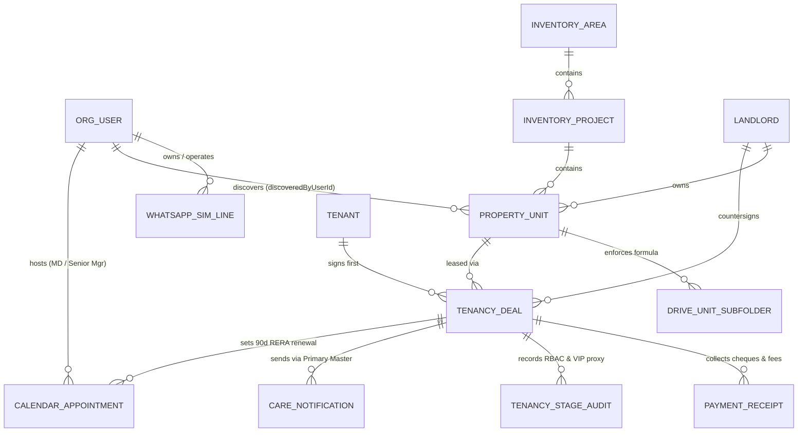
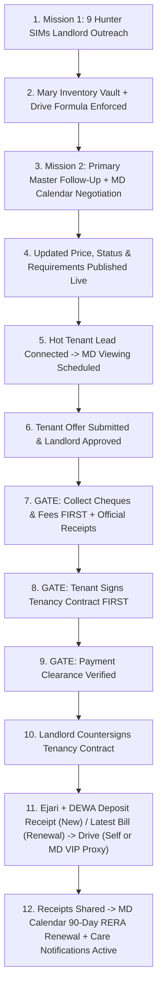

# 🏛️ WHITE CAVES REAL ESTATE LLC — SOVEREIGN RESIDENTIAL LEASING FORMULA, ERD & EXECUTION ROADMAP

**Author:** Arslan Malik (Managing Director — 7 Years Dubai Real Estate Experience)  
**Engineered By:** Aegis Sterling + AICC-Sanctum (`Zoe -> Linda -> Mary -> Henry -> Daisy`)  
**Phase 1 Cash-Flow Focus:** Residential Leasing (DAMAC Hills 2 / Akoya Oxygen first) → Phase 2 Expansion: Secondary Sales & Buying once leasing cash flow is profitable.  
**Last Updated:** 2026-11-21

---

## 1. Domain Entity-Relationship Diagram (ERD)



---

## 2. Organizational RBAC & Clearance Matrix (`leasingRoleClearanceMatrix.ts`)

| Job Role | Clearance | Mary Inventory Visibility | Primary Master WA (`+971505760056`) | Can Add Hunter SIM | Core Responsibilities |
|---|---|---|---|---|---|
| **Managing Director** | **L5** | **ALL Company Inventory** | ✅ Exclusive Closer | ✅ Yes | Solo override for all 12 stages, MD Price Negotiation, Google Calendar, VIP Proxy PDF Upload |
| **Senior Leasing Manager** | **L4** | **ALL Company Inventory** | ✅ Authorized Closer | ✅ Yes | Follow-up, negotiation, offer approval, cheque collection, VIP proxy |
| **Document Controller (Henry)** | **L3** | **ALL Company Inventory** | ❌ Blocked | ❌ No | Payment clearance audit, Ejari/DEWA Drive archival, Drive formula enforcement |
| **Leasing Agent (Future Staff)** | **L2** | **Own Discovered Inventory ONLY** | ❌ Hard-Blocked | ✅ Yes (Hunter Only) | Mission 1 cold landlord outreach, inventory discovery, viewing execution |
| **Landlord / Tenant** | **L1** | Own Unit / Deal Portal Only | ❌ N/A | ❌ No | Portal approvals, signatures, Ejari & DEWA uploads (or WhatsApp VIP handoff to MD) |

---

## 3. 10-Number WhatsApp Hunter/Closer Formula (`leasingSimOutreachFormula.ts`)

- **1 Primary Master Closer (`+971505760056`):**
  - Strictly protected from cold outreach blasts (preserves account reputation under Meta policies).
  - Exclusively handles **Mission 2** landlord follow-ups once a unit is confirmed available, price negotiation scheduling, hot tenant closing, and **Care Notifications**.
- **9 Hunter Outreach SIMs (`+971503869886`, `+971505110636`, `+971589969886`, `+971553633595`, `+971559156636`, `+971505845825`, `+971507160096`, `+971553498722`, `+971567160096`) + Future Human Agent SIMs:**
  - Exclusively execute **Mission 1** paced availability campaigns (`35–65s` Gaussian jitter, `18/hr` per SIM) to discover available rental units and feed Mary's Inventory Vault.
  - **Hard-blocked in code** from sending follow-up, price negotiation, or deal-closing messages.

---

## 4. Universal Google Drive Inventory & Tenancy Stage Formula (`driveInventoryManager.ts`)

```text
Inventory Areas (1g9Vd21YBJ-GB1bLl2jR7pgVGsHeqpi-N)
└── <Area> (e.g. Damac Hills 2)
    └── <Project> (e.g. Pacifica)
        └── <Unit Number> (e.g. 343)
            ├── House Pictures
            ├── Landlord Documents
            ├── Tenant Documents
            ├── Tenancy Contract
            │   └── <Year>_<NEW|RENEWAL>
            │       ├── 01_Offer_&_Approvals
            │       ├── 02_Cheques_&_Receipts
            │       ├── 03_Signed_Contracts
            │       └── 04_Ejari_&_DEWA   (Ejari PDF + DEWA Deposit Receipt [New] or Latest DEWA Bill [Renewal])
            └── Other Documents
```

---

## 5. Enforced 12-Stage Residential Leasing Deal Formula (`tenancyLifecycleFormula.ts`)



---

## 6. Operational Execution Tasks (Priority Order)

1. **Mission 1 (Inventory Generation):** Pair all 10 WhatsApp SIMs (`1` Primary Master + `9` Hunters), launch paced DAMAC Hills 2 landlord availability campaigns from `Akoya-Oxygen-2023-Arslan-only`, and log every available unit in Mary's Inventory Vault.
2. **Mission 2 (MD Negotiation & Calendar):** Share `arslanmalikgoraha@gmail.com` Google Calendar with `gorahabot@white-caves-fb-486818.iam.gserviceaccount.com` ("Make changes to events"), follow up exclusively from `+971505760056`, negotiate price/terms via call/Google Meet, and update Mary's Inventory Vault + `White-Caves-Web`.
3. **Mission 3 (Closing, Ejari/DEWA & Renewal Engine):** Execute tenant viewings → offer/approval → Cheques & Fees First → Tenant Signs First → Payment Clearance → Landlord Countersign → Ejari + DEWA PDF archival (self-service or MD VIP proxy upload) → auto-schedule 90-day statutory RERA renewal notice on Google Calendar + dispatch Care Notifications.
4. **Phase 2 Expansion (Post-Profitability):** Clone this exact Hunter/Closer + RBAC + Drive Formula engine for **Secondary Sales & Buying (Form A / Form B / Form F / DLD Trustee Transfer)** once leasing cash flow is profitable.
