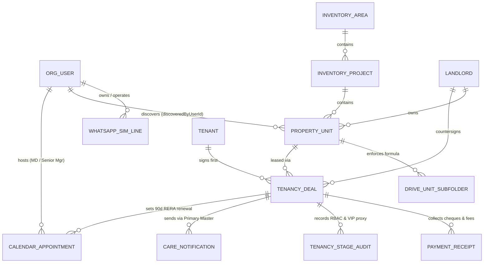
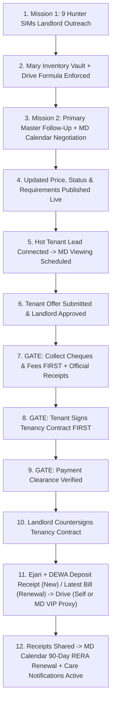

# 🏛️ WHITE CAVES REAL ESTATE LLC — SOVEREIGN RESIDENTIAL LEASING FORMULA, ERD & EXECUTION ROADMAP

**Author:** Arslan Malik (Managing Director — 7 Years Dubai Real Estate Experience)  
**Engineered By:** Aegis Sterling + AICC-Sanctum (`Zoe -> Linda -> Mary -> Henry -> Daisy`)  
**Phase 1 Cash-Flow Focus:** Residential Leasing (DAMAC Hills 2 / Akoya Oxygen first) → Phase 2 Expansion: Secondary Sales & Buying once leasing cash flow is profitable.  
**Last Updated:** 2026-11-21

---

## 1. Domain Entity-Relationship Diagram (ERD)



---

## 2. Full 8-Tier Organizational Authority Chain, RBAC, DMS & TMS (`leasingRoleClearanceMatrix.ts` & `daisyHierarchyAndTmsFormula.ts`)

### 2.1 8-Tier Reporting Authority Chain (Top-to-Bottom & Bottom-to-Top)
- **L8 — `MANAGING_DIRECTOR`**: **Arslan Malik** (Founder & MD — the first and only human employee today; all White Caves HQ open human positions and all AICC-Sanctum AI employees report up to him).
- **L7 — `COO`**: **AI Zoe (`WC-COO-01`)** — reports directly to Arslan Malik (MD).
- **L6 — `DIRECTOR`**: **AI Clara (`DIR-05`)** — Director of Locked Department `DEPT-05 (Sales, Services & Operations)` + `1` Open Human Director Position (`POS-DIR-05`). Reports to AI Zoe (`WC-COO-01`).
- **L5 — `MANAGER`**: **AI Daisy Leasing (`MGR-05-2`)** — Residential Leasing & Tenancy Manager + `1` Open Human Residential Leasing Manager Position (`POS-MGR-05-2`, draggable in DMS under `DEPT-05`). Reports to AI Clara (`DIR-05`).
- **L4 — `ASSISTANT_MANAGER`**: **12 AI Assistant Managers (`AMGR-05-2-01`..`AMGR-05-2-12`)** in Daisy's division + `12` Open Human Assistant Manager Positions (`POS-AMGR-05-2`). Report to AI Daisy (`MGR-05-2`).
- **L3 — `SUPERVISOR`**: **108 AI Supervisors (`9` per Assistant Manager: `SUP-05-2-01-1`..`SUP-05-2-12-9`)** + Open Human Supervisor Positions (`POS-SUP-05-2`). Report to their respective Assistant Manager.
- **L3 — `TEAM_LEADER`**: **1 AI Team Leader (`TL-05-2-01`: AI Layla DH2 Field Team Leader)** + `1` Open Human Team Leader Position (`POS-TL-05-2-01`). Reports to Primary Supervisor (`SUP-05-2-01-1`).
- **L2 — `LEASING_AGENT`**: **10 AI Leasing Agents (`AGT-05-2-01`..`AGT-05-2-10`)** paired with the 10 WhatsApp SIMs + `10` Open Human Leasing Agent Positions (`POS-AGT-05-2`). Report to Team Leader (`TL-05-2-01`).
- **Cross-Cutting Record Keeper — `DOCUMENT_CONTROLLER`**: **AI Henry (`MGR-11-1`)** — sole male AI in AICC-Sanctum, responsible for Google Drive formula enforcement, payment clearance audit, and Ejari/DEWA archival.

### 2.2 Clearance Matrix & Cross-Ecosystem Sync (`TURING-ECOSYSTEM-SYNC-016`)

| Job Role | Clearance | Mary Inventory Visibility | Primary Master WA (`+971505760056`) | Can Add Hunter SIM | Core Responsibilities |
|---|---|---|---|---|---|
| **Managing Director (Arslan Malik)** | **L8** | **ALL Company Inventory** | ✅ Exclusive Closer | ✅ Yes | Solo override for all 12 stages, MD Price Negotiation, Google Calendar, VIP Proxy PDF Upload |
| **COO (AI Zoe `WC-COO-01`)** | **L7** | **ALL Company Inventory** | ✅ Executive Relay | ✅ Yes | Cross-department orchestration & MD escalation |
| **Director (`DIR-05` AI Clara / Human Open)** | **L6** | **ALL Company Inventory** | ✅ Dept Oversight | ✅ Yes | `DEPT-05` Sales, Services & Operations command |
| **Manager (`MGR-05-2` AI Daisy / Human Open)** | **L5** | **ALL Company Inventory** | ✅ Authorized Closer | ✅ Yes | Residential leasing command, Ejari/DEWA compliance, 90-day RERA renewals |
| **Assistant Manager (`12` AI / `12` Human Open)** | **L4** | **ALL Company Inventory** | ❌ Escalates to MD/Mgr | ✅ Yes | Cluster leasing management (`Pacifica`, `Camelia`, `Albizia`, `Basswood`, etc.) |
| **Supervisor (`108` AI = `12×9` / Human Open)** | **L3** | **Cluster/Team Inventory** | ❌ Blocked | ✅ Yes | Sub-cluster zone supervision (`9` supervisors per Assistant Manager) |
| **Team Leader (`TL-05-2-01` AI Layla / Human Open)** | **L3** | **10-Agent Squad Inventory** | ❌ Blocked | ✅ Yes | Leads the 10-Agent WhatsApp & viewing squad |
| **Document Controller (AI Henry `MGR-11-1`)** | **L3** | **ALL Company Inventory** | ❌ Blocked | ❌ No | Payment clearance audit, Ejari/DEWA Drive archival, Drive formula enforcement |
| **Leasing Agent (`10` AI / `10` Human Open)** | **L2** | **Own Discovered Inventory ONLY** | ❌ Hard-Blocked | ✅ Yes (Hunter Only) | Mission 1 cold landlord outreach, inventory discovery, viewing execution |
| **Landlord / Tenant** | **L1** | Own Unit / Deal Portal Only | ❌ N/A | ❌ No | Portal approvals, signatures, Ejari & DEWA uploads (or WhatsApp VIP handoff to MD) |

### 2.3 Labeled TMS Leasing Task Collections (`TMS-LEASE-01`..`TMS-LEASE-06`)
- **`TMS-LEASE-01` (`COL-DH2-MISSION-1-DISCOVERY`)**: Paced WhatsApp Landlord Campaigns Across 9 Hunter SIMs (`Actor: AI Linda MGR-08-1 + 10 AI Leasing Agents AGT-05-2-01..10 -> TL-05-2-01`).
- **`TMS-LEASE-02` (`COL-DH2-MISSION-1-DISCOVERY`)**: Ingest Discovered Units into Mary Inventory Vault & Enforce Google Drive Unit Formula (`Actor: AI Mary MGR-06-1 + AI Henry MGR-11-1`).
- **`TMS-LEASE-03` (`COL-DH2-MISSION-2-NEGOTIATION`)**: Primary Master (`+971505760056`) Landlord Follow-Up, Price Negotiation Call/Meet & MD Calendar Sync (`Actor: Arslan Malik MD + AI Zoe + AI Clara DIR-05`).
- **`TMS-LEASE-04` (`COL-DH2-MISSION-3-WEB-SEO`)**: Generate AI SEO Listings & Publish to `White-Caves-Web` (`/rent/damac-hills-2`) (`Actor: AI Daisy Leasing MGR-05-2 + 12 Assistant Managers`).
- **`TMS-LEASE-05` (`COL-DH2-MISSION-4-CLOSING`)**: Hot Tenant Viewings, Offer Approval, Cheques & Fees First, Tenant Signs First, Clearance & Landlord Countersign (`Actor: AI Zahra EjariDesk AMGR-05-2-11 + AI Daisy MGR-05-2`).
- **`TMS-LEASE-06` (`COL-DH2-MISSION-5-EJARI-RENEWAL`)**: Archive Ejari + DEWA PDF to Unit Drive Folder, Issue Receipts, Set 90-Day RERA Calendar Notice & Care Notifications (`Actor: AI Henry MGR-11-1 + AI Malak Renewals AMGR-05-2-12`).

---

## 3. 10-Number WhatsApp Hunter/Closer Formula (`leasingSimOutreachFormula.ts`)

- **1 Primary Master Closer (`+971505760056`):**
  - Strictly protected from cold outreach blasts (preserves account reputation under Meta policies).
  - Exclusively handles **Mission 2** landlord follow-ups once a unit is confirmed available, price negotiation scheduling, hot tenant closing, and **Care Notifications**.
- **9 Hunter Outreach SIMs (`+971503869886`, `+971505110636`, `+971589969886`, `+971553633595`, `+971559156636`, `+971505845825`, `+971507160096`, `+971553498722`, `+971567160096`) + Future Human Agent SIMs:**
  - Exclusively execute **Mission 1** paced availability campaigns (`35–65s` Gaussian jitter, `18/hr` per SIM) to discover available rental units and feed Mary's Inventory Vault.
  - **Hard-blocked in code** from sending follow-up, price negotiation, or deal-closing messages.

---

## 4. Universal Google Drive Inventory & Tenancy Stage Formula (`driveInventoryManager.ts`)

```text
Inventory Areas (1g9Vd21YBJ-GB1bLl2jR7pgVGsHeqpi-N)
└── <Area> (e.g. Damac Hills 2)
    └── <Project> (e.g. Pacifica)
        └── <Unit Number> (e.g. 343)
            ├── House Pictures
            ├── Landlord Documents
            ├── Tenant Documents
            ├── Tenancy Contract
            │   └── <Year>_<NEW|RENEWAL>
            │       ├── 01_Offer_&_Approvals
            │       ├── 02_Cheques_&_Receipts
            │       ├── 03_Signed_Contracts
            │       └── 04_Ejari_&_DEWA   (Ejari PDF + DEWA Deposit Receipt [New] or Latest DEWA Bill [Renewal])
            └── Other Documents
```

---

## 5. Enforced 12-Stage Residential Leasing Deal Formula (`tenancyLifecycleFormula.ts`)



---

## 6. Operational Execution Tasks (Priority Order)

1. **Mission 1 (Inventory Generation):** Pair all 10 WhatsApp SIMs (`1` Primary Master + `9` Hunters), launch paced DAMAC Hills 2 landlord availability campaigns from `Akoya-Oxygen-2023-Arslan-only`, and log every available unit in Mary's Inventory Vault.
2. **Mission 2 (MD Negotiation & Calendar):** Share `arslanmalikgoraha@gmail.com` Google Calendar with `gorahabot@white-caves-fb-486818.iam.gserviceaccount.com` ("Make changes to events"), follow up exclusively from `+971505760056`, negotiate price/terms via call/Google Meet, and update Mary's Inventory Vault + `White-Caves-Web`.
3. **Mission 3 (Closing, Ejari/DEWA & Renewal Engine):** Execute tenant viewings → offer/approval → Cheques & Fees First → Tenant Signs First → Payment Clearance → Landlord Countersign → Ejari + DEWA PDF archival (self-service or MD VIP proxy upload) → auto-schedule 90-day statutory RERA renewal notice on Google Calendar + dispatch Care Notifications.
4. **Phase 2 Expansion (Post-Profitability):** Clone this exact Hunter/Closer + RBAC + Drive Formula engine for **Secondary Sales & Buying (Form A / Form B / Form F / DLD Trustee Transfer)** once leasing cash flow is profitable.
