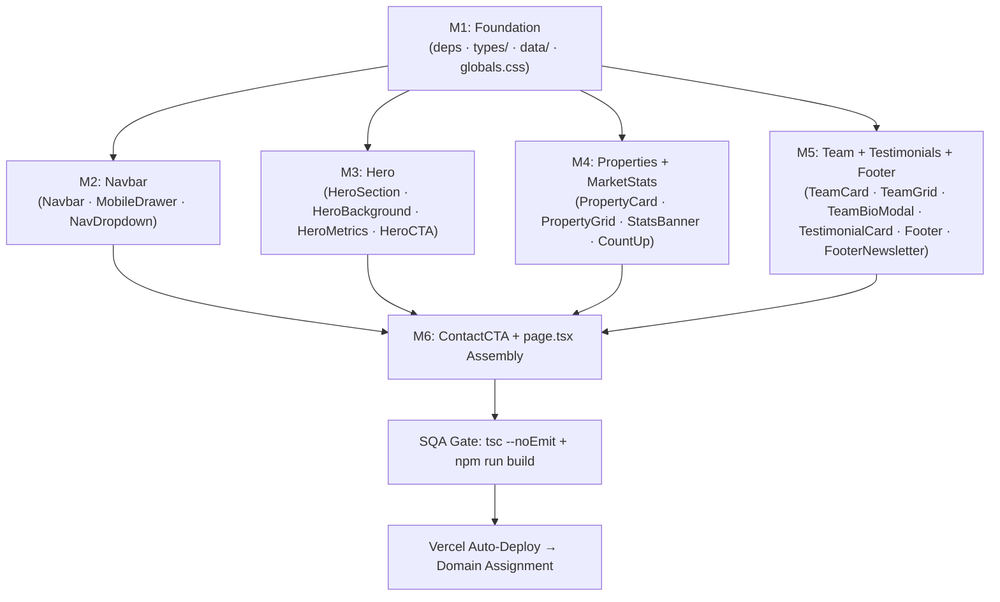

# White-Caves-Web Homepage Migration Plan
> **Author:** @Margaret — Strategic Planner & Roadmap Decomposition Lead  
> **Protocol:** AEGIS V5.0 · Policy `2026.11.06-aegis-v5-unified-mesh-v1`  
> **Status:** `ACTIVE` · **Approved by:** Pending Sovereign Review  
> **Date:** 2026-11-13  
> **Plan Path:** `.agents/plans/white-caves-web-homepage-migration.md`

---

## 1. Executive Summary

**Goal:** Port the public-facing homepage from `White-Caves-Frontend` (Vite/React/Redux) into `White-Caves-Web` (Next.js 16 / React 19 / Tailwind 4), which is live on Vercel and will serve `whitecaves.com`.

**Scope:**
- Migrate UI atoms only — no Redux, no backend calls, no auth
- All static data extracted into `data/` files
- Every output file < 350 lines (AEG-042)
- Single-purpose per file (TURING-SEPARATION-010)
- 12-Way co-location per component folder (AEG-001)
- `tsc --noEmit` gates after every milestone (AEG-022)

**Out of Scope (stays in White-Caves-Frontend/CRM only):**
- Redux / `homepageSlice` / `AppDispatch`
- `VirtualTourModal` & `PropertyComparisonDrawer`
- `useNavigate` / `react-router-dom`
- `LanguageContext` / `ThemeContext` (CRM-only concerns)
- `UserPreferencesDropdown` / session selectors
- Vitest/Playwright tests (added in a later QA wave)

---

## 2. Governing Laws Checklist

| Law | Rule | Enforced By |
|:----|:-----|:------------|
| `TURING-LAW-000 §1` | All independent tool calls batched in one turn | Coordinator |
| `TURING-LAW-000 §2` | Surgical line-range reads only | All agents |
| `TURING-LAW-000 §4` | Zero-token scripts for mechanical multi-file edits | Dept 02 @Una |
| `TURING-LAW-000 §7` | Plan lives in `.agents/plans/` ONLY | @Margaret |
| `AEG-001` | 12-Way co-location per component folder | Dept 02 @Una |
| `AEG-022` | `tsc --noEmit` passes before next milestone | Dept 12 @Rachel_QA |
| `AEG-042` | Every file < 350 lines | Dept 02 @Una |
| `TURING-SEPARATION-010` | data / types / component / logic separated | All agents |
| `TURING-ROOT-007` | Root stays pristine — no loose folders | All agents |

---

## 3. Source Violation Audit (Files Requiring Split)

> Any file ≥ 350 lines in `White-Caves-Frontend/src/components/homepage/` must be split before porting.

| Source File | Lines | Violation | Split Strategy |
|:------------|------:|:----------|:---------------|
| `LuxuryHeroSection.css` | 818 | 2.3× limit | Split → `hero-base.css` + `hero-animations.css` + `hero-responsive.css` |
| `Team.tsx` | 480 | 1.4× limit | Split → `TeamGrid.tsx` + `TeamCard.tsx` + `TeamBioModal.tsx` |
| `FeaturedPropertiesSection.css` | 396 | 1.1× limit | Split → `property-card.css` + `property-grid.css` |
| `ContactCTA.css` | 361 | 1.0× limit | Split → `contact-layout.css` + `contact-form.css` |
| `ContactCTA.tsx` | 347 | At limit | Split → `ContactCTA.tsx` + `ContactForm.tsx` |
| `LuxuryHeroSection.tsx` | 346 | At limit | Adapt + split → `HeroSection.tsx` + `HeroMetrics.tsx` + `HeroCTA.tsx` + `HeroBackground.tsx` |
| `FeaturedPropertiesSection.tsx` | 337 | Near limit | Adapt + split → `PropertyCard.tsx` + `PropertyGrid.tsx` |
| `Hero.css` | 336 | Near limit | Split → `hero-base.css` + `hero-shapes.css` |
| `Testimonials.css` | 331 | Near limit | Split → `testimonials-layout.css` + `testimonials-card.css` |
| `Locations.tsx` | 328 | Near limit | Adapt (remove react-router) — fits as-is after adaptation |

---

## 4. Adaptation Rules: Vite/React → Next.js

| Pattern in Frontend | Replacement in Web |
|:--------------------|:-------------------|
| `import { Link } from 'react-router-dom'` | `import Link from 'next/link'` |
| `import { useNavigate } from 'react-router-dom'` | `import { useRouter } from 'next/navigation'` |
| `` (plain img tag) | `import Image from 'next/image'` with `width`/`height` |
| `import.meta.env.VITE_*` | `process.env.NEXT_PUBLIC_*` |
| `const dispatch = useDispatch<AppDispatch>()` | **DELETE** — use static data |
| `fetchHomepageData()` Redux thunk | **DELETE** — static `market.data.ts` |
| `useSelector(selectFeaturedProperties)` | **DELETE** — static `properties.data.ts` |
| CSS `@import './Component.css'` | Tailwind utility classes or CSS Module (`.module.css`) |
| `motion.` from `framer-motion` | Keep — `framer-motion` is added as dep in M1 |
| `lucide-react` icons | Keep — added as dep in M1 |
| `src="/images/..."` relative paths | Same — `public/images/` already exists in Web |

---

## 5. Target File Architecture

```
White-Caves-Web/src/
├── types/
│   ├── property.types.ts        (< 80 lines)
│   ├── team.types.ts            (< 60 lines)
│   └── market.types.ts          (< 50 lines)
├── data/
│   ├── properties.data.ts       (< 100 lines)
│   ├── team.data.ts             (< 80 lines)
│   ├── market.data.ts           (< 60 lines)
│   └── nav.data.ts              (< 60 lines)
├── components/
│   ├── Navbar/
│   │   ├── Navbar.tsx           (< 180 lines)
│   │   ├── MobileDrawer.tsx     (< 150 lines)
│   │   ├── NavDropdown.tsx      (< 100 lines)
│   │   └── index.ts             (< 10 lines)
│   ├── Hero/
│   │   ├── HeroSection.tsx      (< 180 lines)
│   │   ├── HeroBackground.tsx   (< 80 lines)
│   │   ├── HeroMetrics.tsx      (< 100 lines)
│   │   ├── HeroCTA.tsx          (< 80 lines)
│   │   └── index.ts             (< 10 lines)
│   ├── Properties/
│   │   ├── PropertyGrid.tsx     (< 100 lines)
│   │   ├── PropertyCard.tsx     (< 150 lines)
│   │   ├── PropertyBadge.tsx    (< 60 lines)
│   │   └── index.ts             (< 10 lines)
│   ├── MarketStats/
│   │   ├── StatsBanner.tsx      (< 150 lines)
│   │   ├── CountUp.tsx          (< 60 lines)
│   │   └── index.ts             (< 10 lines)
│   ├── Team/
│   │   ├── TeamGrid.tsx         (< 100 lines)
│   │   ├── TeamCard.tsx         (< 150 lines)
│   │   ├── TeamBioModal.tsx     (< 150 lines)
│   │   └── index.ts             (< 10 lines)
│   ├── Testimonials/
│   │   ├── TestimonialsSection.tsx (< 150 lines)
│   │   ├── TestimonialCard.tsx  (< 100 lines)
│   │   └── index.ts             (< 10 lines)
│   ├── Footer/
│   │   ├── Footer.tsx           (< 180 lines)
│   │   ├── FooterNewsletter.tsx (< 100 lines)
│   │   └── index.ts             (< 10 lines)
│   └── ContactCTA/
│       ├── ContactCTA.tsx       (< 180 lines)
│       ├── ContactForm.tsx      (< 150 lines)
│       └── index.ts             (< 10 lines)
└── app/
    ├── page.tsx                 (< 80 lines — assembly ONLY, no logic)
    ├── layout.tsx               (< 60 lines)
    └── globals.css              (< 100 lines — design tokens + resets)
```

---

## 6. Dependency Graph



> **M2, M3, M4, M5 are parallel** — all depend only on M1.

---

## 7. Daily Milestones

### M1 — Foundation Setup
**AEGIS Dept:** Dept 08 @Gwynne + Dept 02 @Una  
**Estimated LOC diff:** ~180 lines | **SQA Gate:** `tsc --noEmit` ✅

- [ ] `npm install lucide-react framer-motion` in `White-Caves-Web`
- [ ] Copy `public/images/dubai-skyline.jpg` from Frontend to Web
- [ ] Create `src/types/property.types.ts`
- [ ] Create `src/types/team.types.ts`
- [ ] Create `src/types/market.types.ts`
- [ ] Create `src/data/properties.data.ts` (6 static luxury listings)
- [ ] Create `src/data/team.data.ts` (4 static team members)
- [ ] Create `src/data/market.data.ts` (static market stats)
- [ ] Create `src/data/nav.data.ts` (nav links config)
- [ ] Update `src/app/globals.css` (design tokens: `--wc-red`, `--wc-dark`, `--wc-slate`)
- [ ] Update `src/app/layout.tsx` (SEO metadata + font)

---

### M2 — Navbar *(parallel after M1)*
**AEGIS Dept:** Dept 02 @Una | **Estimated LOC diff:** ~430 lines | **SQA Gate:** `tsc --noEmit` ✅

- [ ] Create `src/components/Navbar/NavDropdown.tsx` (hover dropdown atom, < 100 lines)
- [ ] Create `src/components/Navbar/MobileDrawer.tsx` (slide-in mobile menu, < 150 lines)
- [ ] Create `src/components/Navbar/Navbar.tsx` (desktop nav shell, < 180 lines)
- [ ] Create `src/components/Navbar/index.ts`
- [ ] Import `Navbar` into `src/app/layout.tsx`

**Adaptation:** `NavLink` → Next.js `Link` + `usePathname()` for active state; portal CTA → `href="https://app.whitecaves.com"`

---

### M3 — Hero Section *(parallel after M1)*
**AEGIS Dept:** Dept 02 @Una | **Estimated LOC diff:** ~440 lines | **SQA Gate:** `tsc --noEmit` ✅

- [ ] Create `src/components/Hero/HeroBackground.tsx` (skyline + overlays, < 80 lines)
- [ ] Create `src/components/Hero/HeroMetrics.tsx` (4 animated counters, static data, < 100 lines)
- [ ] Create `src/components/Hero/HeroCTA.tsx` (CTA buttons, < 80 lines)
- [ ] Create `src/components/Hero/HeroSection.tsx` (layout shell, < 180 lines)
- [ ] Create `src/components/Hero/index.ts`

**Drops from source:** `useHeroSectionLogic`, `LuxuryMultiTabSearchBar`, `DeveloperFilterQuickChips`, `LuxuryComplianceTrustBadge` — all replaced with inline Tailwind equivalents

---

### M4 — Properties + Market Stats *(parallel after M1)*
**AEGIS Dept:** Dept 02 @Una | **Estimated LOC diff:** ~370 lines | **SQA Gate:** `tsc --noEmit` ✅

- [ ] Create `src/components/Properties/PropertyBadge.tsx` (< 60 lines)
- [ ] Create `src/components/Properties/PropertyCard.tsx` (< 150 lines)
- [ ] Create `src/components/Properties/PropertyGrid.tsx` (< 100 lines)
- [ ] Create `src/components/Properties/index.ts`
- [ ] Create `src/components/MarketStats/CountUp.tsx` (< 60 lines)
- [ ] Create `src/components/MarketStats/StatsBanner.tsx` (< 150 lines)
- [ ] Create `src/components/MarketStats/index.ts`

**Drops:** `VirtualTourModal`, `PropertyComparisonDrawer`, Redux dispatch — CTA replaces with WhatsApp link

---

### M5 — Team + Testimonials + Footer *(parallel after M1)*
**AEGIS Dept:** Dept 02 @Una | **Estimated LOC diff:** ~480 lines | **SQA Gate:** `tsc --noEmit` ✅

- [ ] Create `src/components/Team/TeamCard.tsx` (< 150 lines)
- [ ] Create `src/components/Team/TeamBioModal.tsx` (< 150 lines)
- [ ] Create `src/components/Team/TeamGrid.tsx` (< 100 lines)
- [ ] Create `src/components/Team/index.ts`
- [ ] Create `src/components/Testimonials/TestimonialCard.tsx` (< 100 lines)
- [ ] Create `src/components/Testimonials/TestimonialsSection.tsx` (< 150 lines)
- [ ] Create `src/components/Testimonials/index.ts`
- [ ] Create `src/components/Footer/FooterNewsletter.tsx` (< 100 lines)
- [ ] Create `src/components/Footer/Footer.tsx` (< 180 lines)
- [ ] Create `src/components/Footer/index.ts`

---

### M6 — ContactCTA + Final Assembly + SQA Gate + Deploy
**AEGIS Dept:** @Una + @Rachel_QA + @Gwynne | **Estimated LOC diff:** ~350 lines

- [ ] Create `src/components/ContactCTA/ContactForm.tsx` (< 150 lines)
- [ ] Create `src/components/ContactCTA/ContactCTA.tsx` (< 180 lines)
- [ ] Create `src/components/ContactCTA/index.ts`
- [ ] Rewrite `src/app/page.tsx` — assembly only, < 80 lines, zero logic
- [ ] **SQA:** `npx tsc --noEmit` → 0 errors required
- [ ] **SQA:** `npm run build` → must compile successfully
- [ ] **@Gwynne commit:** `git commit -m "feat(web): homepage migration M1-M6 complete — AEGIS V5.0 compliant"`
- [ ] `git push origin main` → Vercel auto-deploys
- [ ] Verify `https://white-caves-web.vercel.app` renders full homepage
- [ ] Assign domain `whitecaves.com` in Vercel Settings → Domains

---

## 8. AEGIS Department Assignments

| Milestone | Primary Dept | Agent | Secondary |
|:----------|:------------|:------|:----------|
| M1 Foundation | Dept 08 DevOps/SRE | @Gwynne | Dept 02 @Una |
| M2 Navbar | Dept 02 UI/UX Primitives | @Una | — |
| M3 Hero | Dept 02 UI/UX Primitives | @Una | Dept 09 @Victoria |
| M4 Properties + Stats | Dept 02 UI/UX Primitives | @Una | — |
| M5 Team + Testimonials + Footer | Dept 02 UI/UX Primitives | @Una | — |
| M6 Assembly + SQA + Deploy | Dept 12 @Rachel_QA + Dept 08 @Gwynne | Both | @Una |

---

## 9. Zero-Duplication Checklist

**NOT ported to White-Caves-Web (CRM-only, stays in Frontend):**

- [ ] ❌ `homepageSlice.ts` — Redux state
- [ ] ❌ `VirtualTourModal.tsx` — 3D tour modal
- [ ] ❌ `PropertyComparisonDrawer.tsx` — comparison UI
- [ ] ❌ `UserPreferencesDropdown.tsx` — auth preferences
- [ ] ❌ `LanguageContext` / `ThemeContext` — CRM context
- [ ] ❌ `InterestWizard.jsx` — lead capture wizard
- [ ] ❌ `QuickSearchModal.tsx` — CRM search modal
- [ ] ❌ `DldTrakheesiModal.tsx` — CRM compliance modal
- [ ] ❌ All Vitest `.test.tsx` files — added in a future QA wave

---

## 10. SQA Gate Protocol

After **every milestone**, before the next begins:

```bash
cd White-Caves-Web
npx tsc --noEmit
# Expected: zero errors
```

Final M6 gate:
```bash
npm run build
# Expected: "✓ Compiled successfully"
```

---

## 11. Vercel Domain Assignment (Post M6 Deploy)

1. Vercel → `white-caves-web` project → **Settings → Domains**
2. Add `whitecaves.com` → primary domain
3. Add `www.whitecaves.com` → redirect to `whitecaves.com`
4. Add `whitecaves.ae` → optional alias
5. At DNS registrar:
   - `A` record: `@` → `76.76.21.21`
   - `CNAME`: `www` → `cname.vercel-dns.com.`
6. SSL auto-issued by Vercel within 5–15 min

---

## 12. Risk Register

| Risk | Severity | Mitigation |
|:-----|:---------|:-----------|
| `framer-motion` Next.js bundle size | Medium | Use `LazyMotion` + `domAnimation` |
| `<Image>` requires `width`/`height` or `fill` | Low | All images use `fill` with `relative` parent |
| `"use client"` missing on hook-using components | Low | Add at top of every component with `useState`/`useEffect` |
| Missing `dubai-skyline.jpg` in Web public | Low | Copy in M1 from Frontend |
| CSS class name collisions | Low | Use Tailwind utilities; avoid global class names |

---

*Plan authored under AEGIS V5.0 · TURING-LAW-000 · AEG-042 · TURING-SEPARATION-010*  
*Zero tolerance for files > 350 lines. Zero tolerance for plan files in project root.*
